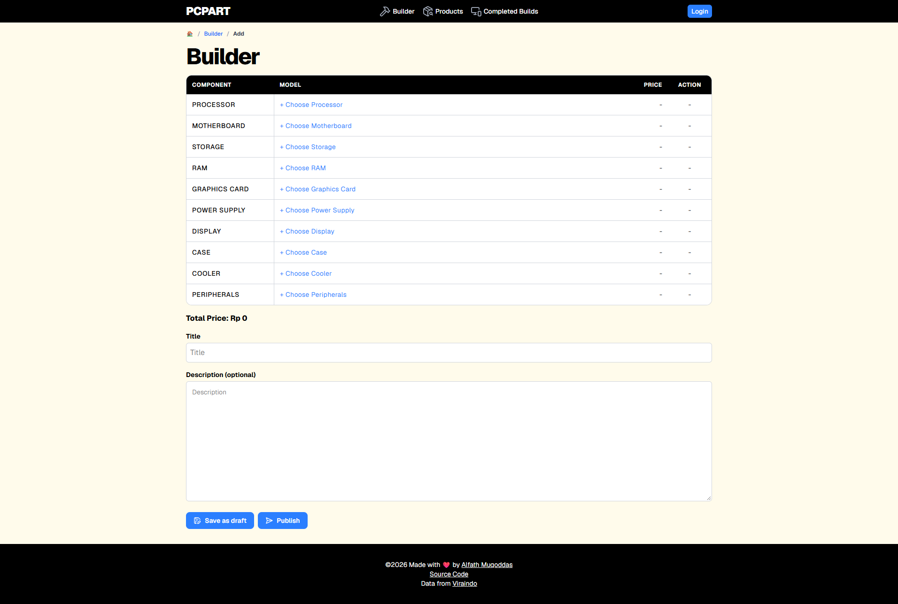
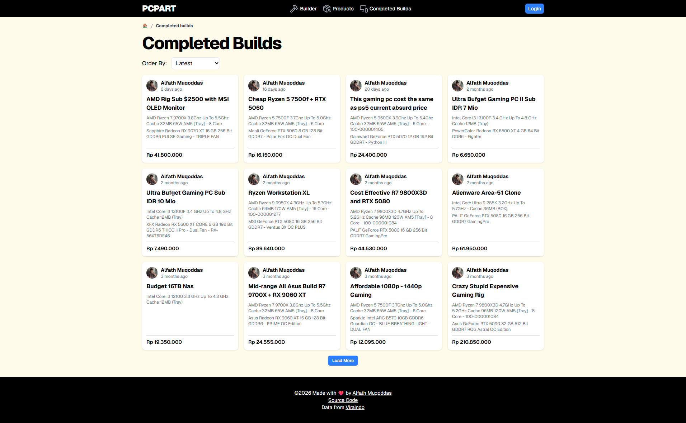

# Viraindo Webscrapper + PCPartPicker Style PC Building tools

This is a simple Astro project that scrapes the [Viraindo](https://viraindo.com) website and then generate a static website and api with the scraped data. It utilize astrojs powerful static-site generation and the [Cheerio](https://cheerio.js.org/) library to scrape the data. [Viraindo](https://viraindo.com) is a pc component store that provides rich pc components and gadget price data but in the form of barebones html site instead of a json api. That's why this project is created to provide a restful api of the website by scraping the html site, and filter out some unnecessary data. It's not a perfect solution but it works for now.

## PCPartPicker Style PC Building Tools

Build your dream pc by selecting the components like CPU, CPU, RAM, etc, and see the total price of the build. You can also login using gmail account and save your builds.

## Screenshots

## Demo

UI Static Site: [https://alfathmuqoddas.github.io/viraindo-webscrapper/](https://alfathmuqoddas.github.io/viraindo-webscrapper/)

API: [https://alfathmuqoddas.github.io/viraindo-webscrapper/api/processor/intel.json](https://alfathmuqoddas.github.io/viraindo-webscrapper/api/processor/intel.json)

## Tech Stack

- Astro
- Preact
- Tailwind CSS
- Cheerio
- Firebase Auth
- Firebase Firestore

## Getting Started

1. Clone the repository
2. Install dependencies with `npm install`
3. Run the project with `npm run dev`
4. Open [http://localhost:4321](http://localhost:4321) to view the app
